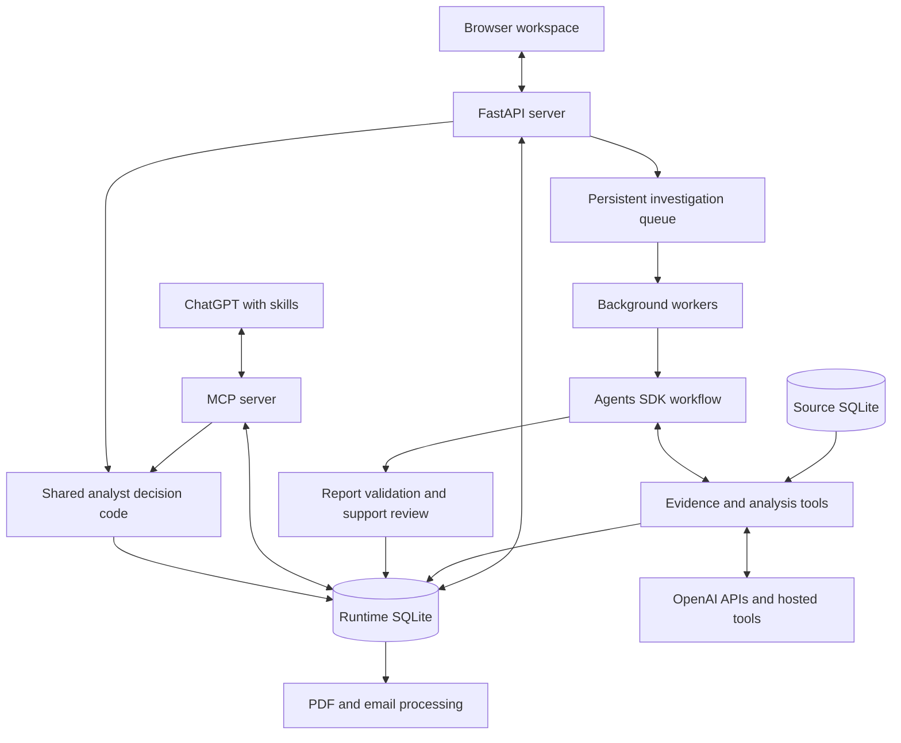

# Trade Surveillance — Architecture and Implementation

This is the build documentation for the application. It explains how the code works, how its components connect, what is deterministic, where models are involved, and what remains prototype infrastructure. It is not a presentation script.

## 1. System overview

The app starts with an existing surveillance alert. It does not use a language model to detect every suspicious trade in the source population. Upstream rule alerts are grouped into cases, and the investigation service prepares evidence-backed drafts for analyst review.

There are two interfaces to the same persisted workflow:

1. A local browser application served by FastAPI.
2. ChatGPT, connected to an MCP server that exposes selected case reads and analyst actions.

The application owns data access, case state and decisions. OpenAI models interpret retrieved evidence, choose enabled investigation tools and generate structured assessments. Hosted services perform tasks such as policy retrieval, transcription and Python execution.



The diagram describes logical dependencies. Workers run inside the FastAPI process in this implementation; they are not a separate managed queue service. The MCP server runs as a separate process and uses the same configured application code and databases.

### Main technologies

| Component | Implementation |
|---|---|
| Browser UI | HTML, CSS and JavaScript in `sample/population.html` |
| HTTP service | FastAPI in `app/server.py` |
| Background execution | Async tasks plus thread offloading in the server lifespan |
| Source and operational persistence | SQLite |
| Agent runtime | OpenAI Agents SDK with `Agent`, `Runner` and `FunctionTool` |
| Model access | OpenAI Python SDK and Responses-backed agent models |
| ChatGPT integration | FastMCP server plus packaged/personal skills |
| Analytics | Supplied Python recipe using pandas and matplotlib, executed in hosted Code Interpreter |

The configured default investigation model is `gpt-4.1`, the embeddings default is `text-embedding-3-small`, and transcription defaults to `whisper-1`. These are code defaults, not a guarantee that a deployed environment has no overrides. Configuration is loaded from the ignored `.env`; never publish or dump that file.

## 2. Repository map

| File or directory | Responsibility |
|---|---|
| [server.py](../app/server.py) | HTTP routes, local-request checks, background tasks and lifecycle |
| [runtime.py](../app/runtime.py) | Queue, runs, snapshots, reviews, operational metadata and audit persistence |
| [sdk_workflow.py](../app/sdk_workflow.py) | Agent definitions, execution state, enabled tools, budgets and report stages |
| [agent.py](../app/agent.py) | Domain instructions, tool definitions, report/citation checks and investigation entry point |
| [models.py](../app/models.py) | Pydantic schemas for reports, claims, citations and workflow requests |
| [evidence_tools.py](../app/evidence_tools.py) | Scoped evidence reads, communications ranking and policy File Search |
| [indexes.py](../app/indexes.py) | Policy uploads/vector store setup and communications embedding initialization |
| [investigation_extensions.py](../app/investigation_extensions.py) | Timeline, historical comparisons, recording transcription and follow-up evidence helpers |
| [prior_case_search.py](../app/prior_case_search.py) | Embedding-based ranking of eligible historical case summaries |
| [market_news.py](../app/market_news.py) | Public news search and interpretation |
| [image_evidence.py](../app/image_evidence.py) | Image eligibility, model reading, caching and quote checks |
| [quantitative.py](../app/quantitative.py) | Dataset scoping, Code Interpreter call, artifact retrieval and metric validation |
| [execution_chart_recipe.py](../app/execution_chart_recipe.py) | The supplied analytics program executed in Code Interpreter |
| [reviews.py](../app/reviews.py) | Shared analyst actions used by the app and ChatGPT |
| [manager.py](../app/manager.py) | Manager-stage ownership and decisions |
| [escalations.py](../app/escalations.py), [notifications.py](../app/notifications.py) | Escalation packets, PDFs, email outboxes and delivery handling |
| [chatgpt_mcp.py](../app/chatgpt_mcp.py), [chatgpt_cases.py](../app/chatgpt_cases.py) | MCP tool surface, current case retrieval and decision proposals |
| [chatgpt_audio.py](../app/chatgpt_audio.py) | Embedded ChatGPT audio playback |
| [observability.py](../app/observability.py) | Trace spans and SDK/API instrumentation |
| [evaluation.py](../app/evaluation.py), [evals](../evals) | Evaluation logic and supporting criteria |
| [replay.py](../app/replay.py) | Saved-run replay and artifact checks |
| [sample/population.html](../sample/population.html) | Served workspace, including custom evidence and chart UI |
| [scripts](../scripts) | Population generation, rendering, MCP launch and maintenance utilities |
| [chatgpt-skills](../chatgpt-skills) | Skill packaging and instructions |

## 3. Data model and storage

### Source data versus runtime state

`data/population.sqlite3` is the investigation source population. It contains parent orders, fills, alerts, grouped cases, venue-order activity, account records and evidence. The tools treat it as a source, rather than modifying trading records to match an assessment.

`data/agent.sqlite3` stores operational state. A case can have multiple investigation runs, each with its own revision, evidence snapshots, report and events. The same source case ID can therefore be associated with an earlier escalation and a later pending review.

| Runtime table | Purpose |
|---|---|
| `runs` | Run ID, case ID, revision, status, report, depth, timing, parent run and reviewer request |
| `snapshots` | Evidence payloads retrieved into a particular run, keyed by evidence ID |
| `audit` | Ordered events such as tool execution, provisional assessments, validation and decisions |
| `embeddings` | Locally stored communications vectors plus model and source hash |
| `meta` | Index identifiers, initialization flags and cached operational information |
| `reviews` | Human review notes and selected actions |
| `chatgpt_proposals` | Staged decisions, expiry, status, token hash and committed result |
| `manager_cases` / `manager_actions` | Active manager state and manager decision history |
| `submitted_evidence` | Later analyst-supplied documents and provenance |
| `escalation_packets` | Immutable decision snapshot plus PDF and delivery state |
| `notifications` | Draft-ready email outbox |
| `demo_events` | Delivered alert events and their associated runs |

Selected audit and evidence records have SQLite triggers preventing ordinary update/delete operations. This is useful integrity protection within the app, but is not a production tamper-proof records platform: the machine/database administrator still controls the files.

### Files outside SQLite

Image and recording archives live under the configured investigation archive. Quantitative artifacts are saved under a run-specific directory in `data/analysis_artifacts`. Escalation PDFs are stored under the configured PDF output directory. Replays preserve earlier run records and artifacts separately.

The GitHub repository contains the source code. Secrets, the virtual environment and runtime databases/artifacts are excluded; cloning the repository is not the same as copying the full configured local runtime.

### Stable identifiers

- **Case ID:** the grouped surveillance case, for example `CASE-0088C625`.
- **Run ID:** one investigation execution or explicitly copied review revision.
- **Revision:** the case's ordered investigation/review version.
- **Evidence ID:** a retrieved source or derived result that claims can cite.
- **Trace ID:** the observability record for an instrumented execution.
- **Proposal ID:** one staged ChatGPT decision, bound to the intended run and action.

A case ID is not an order ID or trace ID. Always retrieve the current revision before changing a case. A copied review revision reusing prior results is not a newly executed model investigation.

## 4. Server, queue and browser lifecycle

`server.py` uses a FastAPI lifespan function to initialize persistence and recover unfinished operational state. If retrieval indexes are ready, it starts the configured investigator workers and an intake loop. It also starts notification and escalation workers.

The code default is four investigator workers. Each claims a persisted queued run, marks it running and executes the bounded investigation in a thread. Thread offloading keeps blocking SDK/database work from occupying the HTTP event loop. It does not make the service a distributed job platform.

The source of truth for progress is the database. The UI reads workspace and activity routes to show real saved events, current checks, report readiness and decisions. The live activity display is not a scripted animation or access to private model reasoning.

Important HTTP routes include:

| Route | Role |
|---|---|
| `/population.html` | Analyst workspace |
| `/api/workspace` | Current queue and case state |
| `/api/activity` | Persisted investigation progress |
| `/api/cases/{case_id}/history` | Revision history |
| `/api/cases/{case_id}/analysis/{run_id}/{filename}` | Saved quantitative artifacts after application checks |

See the route decorators in `server.py` for the full API. Route access checks are designed for a loopback-only demonstration. Host/origin/header checks reduce accidental misuse; they are not enterprise authentication or per-user authorization.

## 5. From alert to completed draft

1. **Intake:** a known source case is queued, or a delivered event resolves to an existing active run. The runtime persists the job before workers execute it.
2. **Claim:** a worker atomically claims a queued run. Case context includes linked orders, accounts, securities, alert families and evidence cutoff.
3. **Initialize:** `InvestigationState` constructs evidence tools, the deadline, required checks, depth and completed/failed tool sets.
4. **Investigate:** the model chooses from enabled SDK tools. Application code validates arguments, enforces state and records results as evidence snapshots.
5. **Record the initial assessment:** after essential checks, the agent must preserve a cited provisional view. This is a checkpoint, not the final report.
6. **Deepen when required:** complex alert families, material gaps or concerning/inconclusive findings can require deeper investigation. The application gates later steps accordingly.
7. **Finish evidence gathering:** the finish tool is available only when required checks and depth requirements are satisfied and mandatory tools have not failed.
8. **Write:** a separate report-writing agent returns a Pydantic `Report`.
9. **Validate:** deterministic checks and a separate model support review inspect the draft. There is one repair opportunity.
10. **Persist:** a passing draft becomes `ready_for_review`; evidence and events remain available. Draft notification is queued separately.
11. **Human decision:** an analyst can escalate, request more evidence or mark reviewed. Manager-stage controls apply after escalation.

### Adaptive decisions inside fixed boundaries

The model is not simply executing an entirely unconstrained prompt. The app defines a state machine around it. `allowed()` determines which tools are enabled at a given stage; `control_state()` tells the model what remains; `invoke()` validates actual calls and records successes/failures.

Every run requires core checks such as trades, baseline, authority, market context, market news and policy. Other requirements are added from the alert family, attached images, available recordings and submitted evidence. For spoofing/layering, execution-pattern analysis is required. The agent can choose useful queries and investigate relevant leads within these constraints.

Tool calls are configured sequentially (`parallel_tool_calls=False`) so later choices can use earlier results. The code defaults are a 24-call budget and a 360-second job deadline; these are operational limits, not measured latency guarantees.

## 6. What the three agents do

### Investigator

The investigator uses SDK `FunctionTool` objects generated from the app's tool definitions. The model requests a named tool with structured arguments; the SDK invokes a Python wrapper, which calls `InvestigationState.invoke`, which delegates to the application evidence tool.

Each tool result returns evidence plus control state. The agent can use the result on the next turn. Retrieved content is treated as evidence, not instructions to change the workflow or permissions.

### Report writer

The writer receives the investigation history and produces the required schema. A report contains an assessment, recommendation, cited summary, observations, alternatives, gaps and reviewer questions. Assessment values include `concerning`, `plausibly_benign` and `inconclusive`; recommendations include `escalate`, `standard_review` and `request_more_evidence`.

Structured output constrains the shape and allowed values. It does not establish that the statements are true.

### Evidence support reviewer

The reviewer receives the case, draft and retrieved evidence, then returns a `GroundingVerdict`. It looks for unsupported statements and identifies problems for repair. This is a separate model call with a different task, not an independent human or guaranteed independent source of truth.

The application combines that verdict with its own checks. A fluent report or favorable model review cannot override a failed required control.

## 7. Retrieval: four different mechanisms

### A. Structured database retrieval

Trades, fills, venue orders, authority and related records are obtained through application queries. Queries restrict the relevant orders/accounts and time window. Some checks are limited extracts, so reports must qualify conclusions to the returned coverage.

The historical trade baseline is a structured comparison over prior trading records. It is different from finding a semantically similar historical investigation.

### B. Communications embeddings and hybrid ranking

Initialization embeds available source communications with the configured embedding model at 512 dimensions. The runtime stores the vectors locally, keyed by source ID, hash and model. A vector is a numeric representation for similarity search, not an assessment or permission grant.

For a communications query:

1. Restrict eligible source records using application scope and availability.
2. Embed the query through OpenAI.
3. Load compatible stored vectors for eligible messages and retrieved transcripts.
4. Compute cosine similarity locally.
5. Compute lexical overlap locally.
6. Rank with `0.8 × semantic similarity + 0.2 × lexical overlap` and return up to five scored records, alongside relevant denied/unavailable markers.

This is not keyword-only search. It is also not hosted File Search: the app implements the ranking over local vectors. Missing usable embeddings are an error, not a reason to silently pretend semantic retrieval succeeded.

### C. Historical case similarity

`retrieve_prior_cases` constructs eligible comparison candidates. `prior_case_search.py` embeds/caches their bounded summaries and embeds the query. It ranks by cosine similarity, using lexical overlap and stable metadata to break ties, and returns up to three matches.

This is distinct from the communications weighted formula. Comparison candidates are filtered before ranking. Similarity supports an investigative analogy; it does not transfer another case's evidence or disposition to the current case.

### D. Hosted policy File Search

`indexes.py` uploads policy PDFs, or Markdown fallbacks, into an OpenAI vector store with family attributes. A content fingerprint allows setup to reuse an unchanged index.

The policy tool calls Responses with a required `file_search` tool, a vector-store ID and a family filter. It requests retrieved results and records the actual policy excerpts, file IDs, scores and response identifiers. The app cites the retrieved excerpts rather than relying solely on a generated policy summary.

Policy documents and the vector store are hosted resources with their own lifecycle. Their existence is separate from whether an individual Responses request is stored.

## 8. Audio and screenshot evidence

### Audio

The app selects an eligible recording linked to the case, sends the file to `audio.transcriptions.create`, and stores the resulting transcript and provenance. Cached transcripts can be reused; the audit event distinguishes reuse from a new call. Transcript text can then be embedded for communications search.

The demo recording is an AI-generated reenactment of a source conversation. It is not an independent recording from a real trading desk. Transcription extracts speech content; the app is not claiming to prove deception, intent or emotional state from vocal tone.

### Images

The vision path sends an eligible image to a vision-capable model using Responses and requests an `ImageReading` structure. A cache key includes the image hash and model. Extracted quotes are checked against paired source text.

The screenshot is a rendered view of synthetic records. Pixel interpretation can help read the attached evidence, but checking a quote against its source does not authenticate a screenshot or prove all model interpretations correct. A source message and its rendered image must not be counted as two independent corroborating sources.

“Vision” describes an input capability of the model. This app does not call a separate product named the “reasoning API” to read screenshots.

## 9. Code Interpreter and the Python recipe

### The exact call path

```mermaid
sequenceDiagram
    participant A as Investigator
    participant T as Application analysis tool
    participant O as Responses / Code Interpreter
    participant P as Supplied Python recipe
    A->>T: analyze_execution_patterns(query)
    T->>T: Scope orders, fills and venue data
    T->>O: Upload JSON and recipe; request hosted execution
    O->>P: Execute recipe with case data
    P-->>O: analysis.json and execution_pattern.png
    O-->>T: Results and generated files
    T->>T: Recompute metrics, validate, hash and save artifacts
    T-->>A: Quantitative evidence and artifact metadata
```

The model's tool arguments are not the entire dataset. Application code constructs the dataset from the case. The supplied recipe already exists in the repository before the run; it is uploaded, not freshly authored by the investigator.

`quantitative.py` calls `responses.create` with `tools=[{'type': 'code_interpreter', ...}]`, requiring tool use and requesting interpreter outputs. The prompt directs the tool to execute the uploaded recipe through `runpy.run_path` rather than substitute a new analysis program.

### Recipe responsibilities

`main()` reads `case_activity.json`, calls `calculate_metrics`, saves `analysis.json`, and calls `render_chart` to write `execution_pattern.png`.

The calculations include execution counts, executed shares by side, executed notional, minute-level buckets, the proportion of case execution shares in the session's final five minutes, and cancellations within the supplied venue-order extract. Different denominators answer different questions: case-share concentration is not market participation, and venue cancellations are not a count of cancelled parent orders.

`render_chart()` uses the same supplied data and metrics to create a matplotlib visualization. Python draws the chart; the model does not manually choose each plotted pixel.

### Validation and cleanup

The backend independently recomputes expected measurements, compares them with the hosted output and checks downloaded artifact constraints. Files are saved under the run with SHA-256-based identities. The server checks artifact paths and case/run association when serving them.

The cleanup path attempts to delete the temporary container and uploads. A cleanup failure is recorded for attention; cleanup code is not a universal retention guarantee. Local checked artifacts are retained intentionally so a saved report can display its chart without keeping the hosted container alive.

Numerical validation does not prove every chart pixel, label, financial interpretation or underlying source record is correct.

## 10. Report validation and failure behavior

There are separate layers:

| Layer | What it checks | What it does not prove |
|---|---|---|
| Pydantic / structured output | Required fields, types and allowed values | Truth of a claim |
| Citation and quote checks | Referenced evidence exists and quoted text matches retrieved content | Whether that source is authentic or the quote fully supports the interpretation |
| Workflow checks | Required tools, depth and stage requirements were met | Completeness of the external evidence universe |
| Quantitative checks | Returned metrics match independent computations over supplied rows | Complete market impact or intent |
| Model support review | Potential unsupported statements and contradictions | Guaranteed correctness or human expert approval |
| Analyst review | A person evaluates evidence and chooses a workflow action | Automatic compliance certification |

A tool failure becomes an unavailable evidence record and an audit event. Failed mandatory checks prevent completion. Budget exhaustion, initialization failures or a draft still failing after its repair opportunity route the run to `manual_review` rather than manufacture a successful report.

An empty search is not proof no evidence exists. Access denied is not “no concerning evidence.” A missing approval is a gap to investigate, not proof of an unauthorized trade. The instructions and checks preserve these distinctions.

## 11. ChatGPT, MCP, skills and UI

### MCP is the application interface

`chatgpt_mcp.py` exposes functions such as:

- `find_surveillance_cases`: search existing cases and statuses.
- `get_case_assessment`: retrieve the current or requested revision and cited evidence.
- `read_case_section` / `get_case_source`: retrieve specific details or exact source text.
- `view_case_chart` / `play_case_recording`: show saved permitted artifacts.
- `prepare_analyst_decision`: stage an exact proposed action.
- `submit_analyst_decision`: execute an authorized staged action through the shared workflow.

The MCP server is not the investigation model and does not give ChatGPT unrestricted SQL or arbitrary shell access. It exposes explicit functions with schemas and application guards. Reading the saved report does not rerun the investigation.

### Skills are reusable instructions

`case-review` requests a concise first answer, `details` guides deeper evidence retrieval, and `escalate` guides a staged decision. They instruct the assistant to use live tools, preserve uncertainty, respect pagination and distinguish preparation from submission.

Skills do not create backend functions or grant data access. They also do not themselves enforce permissions. Compact text such as `/detailsCASE-0088C625` is interpreted by instructions; it is not evidence that every client registers that entire string as a UI command.

### Three sources of visible presentation

1. **Generated formatting:** ChatGPT formats tool results as summaries, headings, lists, links and timelines. Exact presentation can vary.
2. **Registered custom components:** tool metadata such as `ui.resourceUri` and `openai/outputTemplate` associates a tool with registered HTML/JavaScript for chart/audio experiences.
3. **Host controls:** ChatGPT supplies its native approval UI according to tool permissions and host policy. The skill is not the implementation of the approval button.

The registered legacy decision component remains in the code for compatibility. The current MCP instructions direct consequential writes through native approval rather than sending the user to an embedded confirmation card.

## 12. Decisions, revisions and email

Both the HTTP app and ChatGPT call `reviews.record_review`. There is one shared workflow rather than separate app and chat status stores.

A ChatGPT proposal binds an action to the exact case, run, note and optional submitted evidence. Submission validates the proposal, expiry and latest revision. The transaction checks that the run is awaiting an eligible action, then records the human review and updates state. Retry handling prevents an already committed proposal from producing duplicate actions, while stale receipts are rejected when their saved result no longer matches current workflow state.

| Action | Persisted effect |
|---|---|
| Escalate | Mark escalated, open manager review and queue an escalation packet |
| Mark reviewed | Mark reviewed, subject to manager-stage restrictions |
| Request more evidence | Preserve the previous revision and create a new queued run linked to its parent; store submitted evidence when supplied |

Submitted documents are marked with their receipt time and provenance. They belong to the follow-up lineage rather than being silently inserted into the original source cutoff.

PDF generation and email delivery have separate status fields. A recorded escalation can be successful even while PDF/email processing is pending or blocked. “Queued,” “accepted by SMTP” and “delivered to the inbox” are different claims. SMTP acceptance does not prove inbox delivery.

The ready-for-review queue reflects workflow status. An agent recommendation of `escalate` does not itself make the case escalated. Earlier revision history can still contain a real recorded escalation after a later review copy is created.

## 13. Traces, audit events and evaluations

### Three records with different purposes

- **Runtime audit:** durable local application events, including workflow state and human decisions.
- **OpenAI trace:** instrumented agent/model/tool execution for inspection, timing and debugging when tracing is enabled.
- **Evaluation result:** a grade against explicitly configured criteria and supplied input.

The SDK configures tracing in `run_sdk`; `observability.py` adds spans and captures relevant calls/events. Sensitive tool inputs/outputs can be present when enabled. A trace is not a substitute for enterprise audit retention and is not a view into private model chain-of-thought.

Use traces to find which tool failed, inspect actual arguments and outputs, locate latency, and compare execution across changes. If the trace is incomplete, a grader may lack the final report it was asked to evaluate. That is different from proving the report was wrong.

Trace-level grading can inspect process behavior. Saved-report evaluation can directly score final content against evidence and criteria. Neither is automatically superior; the evaluation input must contain what its criterion requires.

The broad tool-consistency check used in the demo only verifies successful relevant tools and consistency with their returned outputs. It is not a comprehensive quality test. Stronger evaluation should separately measure required evidence coverage, material claim support, appropriate recommendations, failures, latency and cost across representative cases. Synthetic scenario agreement is not a production false-positive/false-negative estimate.

## 14. Security boundaries and retained data

The current server is deliberately single-user and loopback-oriented. It does not implement production SSO, complete per-user case authorization, a hardened external deployment or regulatory records retention. Application scoping exists, but must not be presented as a complete enterprise identity system.

Data can be present in multiple places:

| Location | Examples |
|---|---|
| Local source database | Orders, fills, synthetic evidence and public market records |
| Local runtime | Snapshots, reports, vectors, reviews and audit events |
| Local files | Images, audio, generated charts, PDFs and backups |
| OpenAI requests | Retrieved text, audio, images, policy queries and Code Interpreter input |
| Hosted resources | Policy vector store/files and temporary analysis resources |
| Traces and stored responses | Evidence and outputs depending on instrumentation/request settings |
| ChatGPT conversation | User requests and tool results presented in the chat |
| Email system | Notification/summary content and attachments when configured |

Main SDK agents and market-news calls explicitly use `store=True`; vision and quantitative Responses calls use `store=False`. Policy calls do not explicitly set that option in the tool implementation. Do not describe the entire app as using `store=False`.

Response storage, hosted files/vector stores, tracing, application persistence and ChatGPT conversation retention are separate concerns. `store=False` is not a claim of Zero Data Retention. Eligibility and retention policies must be checked against current provider documentation and account configuration before using real sensitive data.

Production work includes identity, case/source authorization, encryption and key management for app-owned storage, approved data flow and residency, secrets management, lifecycle/deletion controls, controlled logging, security testing and operational monitoring. A human approval button addresses action authorization; it does not solve these other controls.

## 15. Operations and maintenance

### Start the existing configured application

From the repository root:

```sh
.venv/bin/uvicorn app.server:app --host 127.0.0.1 --port 8767
```

Open `http://127.0.0.1:8767/population.html`. The served app needs its API backend; opening the HTML file directly is not equivalent.

### Initialize a fresh checkout

Follow the root README for creating the virtual environment, installing dependencies, configuring `.env`, building the source population and initializing indexes. Index setup and investigations can incur paid API usage. Do not regenerate an existing population or replace a runtime as a routine startup step.

### ChatGPT connection

The stdio entry point is [run_chatgpt_mcp.py](../scripts/run_chatgpt_mcp.py). Connection lifecycle helpers are in [chatgpt_connection.py](../scripts/chatgpt_connection.py). App availability and MCP connectivity are distinct: an HTTP page can work while the ChatGPT connection is unavailable. Configuration must point both processes at the intended source/runtime.

### Frontend maintenance

`sample/population.html` is the served file and contains custom additions. `scripts/population.template.html` and supporting JS are generator inputs, but not every manual customization is synchronized into those inputs. Blind regeneration can overwrite custom image or evidence UI. Inspect differences and preserve these additions when changing the UI. A future refactor should make the generator the complete source of truth or separate maintained frontend assets cleanly.

### Troubleshooting

| Symptom | Checks |
|---|---|
| App will not load | Confirm the uvicorn process, port, correct working directory and HTTP response. |
| Case stays queued | Check index readiness, active workers, available API credit and worker errors. |
| Search finds no semantic results | Check embedding model compatibility, index initialization and available scoped candidates. Do not substitute a fabricated result. |
| ChatGPT shows old status | Retrieve the current case/revision through MCP; prior chat text does not update itself. Check connection points to the intended runtime. |
| Escalation does not appear | Inspect the submission result, exact run/proposal, app status and manager state. Preparation alone does not change a case. |
| Chart unavailable | Check that the selected revision has quantitative evidence and that its run-specific files/hash match. |
| Evaluation is pending or errors | Check credit, actual job/grader error, supported configuration and whether the supplied input covers the criterion. |
| Email blocked | Inspect PDF/outbox/delivery state and SMTP configuration; do not infer inbox delivery from a queue entry. |

### Testing and changes

The `tests` directory covers workflow, source scoping, calculations, artifacts, model-output validation, MCP decisions and other boundaries. Choose focused tests for the change. Avoid live API/email jobs just to verify a text or UI edit. Meaningful end-to-end checks must verify the resulting persisted state, not only a successful HTTP/tool response.

The local app is the current deployment. Vercel migration remains paused. Exposing this server publicly would require deployment, persistence, background-work and security changes; it is not just changing a URL.

## 16. Worked example: Apple spoofing/layering case

The source case `CASE-0088C625` illustrates the architecture without defining a predetermined outcome.

1. The linked orders include three 300-share sells and nine much larger buy orders. In the supplied venue extract the buy orders are cancelled without fills, while 900 sell shares execute.
2. Structured tools reconstruct that sequence and retrieve relevant authority, baseline and market context.
3. Communications retrieval looks for relevant language. The recording reenacts one original message; the later desk screenshot represents a different source conversation. Each carries provenance and limitations.
4. The analysis tool supplies the scoped order/fill/venue data and Python recipe to Code Interpreter. The app validates the numerical result and stores the chart.
5. Policy File Search returns applicable excerpts. Historical case retrieval may return an analogous synthetic summary; the match does not prove current intent.
6. The agent weighs the suspicious pattern against the approved hedge-related alternative. Daily market data cannot establish causal price impact.
7. A structured draft is checked and stored. Its recommendation is separate from a human decision.
8. The browser or ChatGPT can retrieve that saved assessment. A requested escalation is staged/approved/validated before being recorded and creating manager work.

The model interprets evidence within the application workflow. It does not own trading data, decide user permissions, silently modify orders, or independently make a final regulatory determination.

## Suggested reading order

For architecture, read sections 1–5, then `server.py`, `runtime.py` and `sdk_workflow.py`. For AI behavior, read sections 6–10 alongside the evidence and analysis modules. For ChatGPT/actions, read sections 11–12 and the MCP/review modules. For running and extending the system, read sections 13–15 plus the root README.

Related detail: [data model](DATA_MODEL.md), [source population](POPULATION.md), [agent runtime](AGENT_RUNTIME.md). The separate [demo guide](DEMO_GUIDE.md) is a presentation aid, not the architecture reference.
