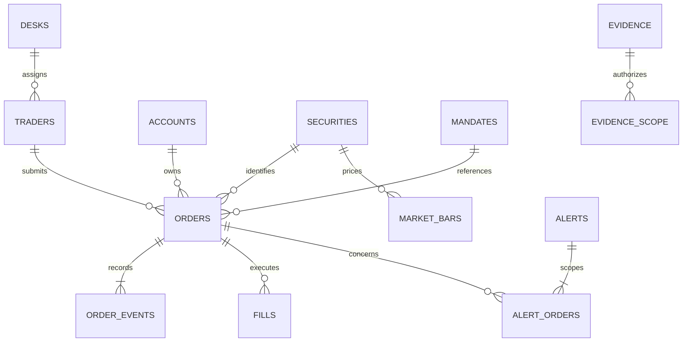

# Trading data design for review

The full population has now been generated. See [POPULATION.md](POPULATION.md) for its current outputs and checks. The sections below describe the earlier small review sample and initial design decisions.

Status: proposed model with a reproducible sample using real US equities and sourced historical daily prices/volumes. Trading activity, bank employees, accounts, private communications, entitlements and venues are simulated. Public facts are individually cited. This is not an exchange simulator or a claim about actual misconduct. The old fictional-issuer examples in `app/fixtures.py` are inactive agent scaffolding and must be replaced before agent work resumes.

## Target dataset, after sample review

| Entity | Target | Design intent |
| --- | ---: | --- |
| Trading sessions | 60 completed sessions plus an investigation cutoff | Historical baselines never include future activity |
| Executions | About 150,000 | Sliced fills, differing order sizes and trading intensity |
| Parent orders | About 40,000 | Several fills per order; some unfilled or partly cancelled |
| Traders / desks | 24 / 4 | Desk-specific mandate, size and activity distributions |
| Client and internal accounts | 40 | Named account purpose and ownership constraints |
| Real equities | 30 | Sector, liquidity and volatility differences |
| Market bars | One-minute bars per session/security | Prices and volume generated before executions |
| Communications | Thousands, with a final count based on coverage | Mundane conversation, repeated terms, indirect leads, counter-evidence |
| Mandates, news, relationships, access records | Linked to relevant activity plus background records | Evidence is independently meaningful and time-aware |

These are proposed scale targets, not claims that data already exists. Sample counts are measured in `sample/manifest.json`.

## Unit of investigation

An execution is a fill. A parent order expresses trading intent and can have multiple fills and amendments. An alert can concern one order, a sequence of orders, or a trader/account/security/time window. Several alerts can refer to overlapping activity. Deduplicate incoming events by source event ID, not by trader or security.

The sample models parent orders and their event history. Child venue-routing orders, exchange queue priority, settlement, allocations, short locates and trade corrections are deferred; do not imply that the sample reproduces exchange protocols. A sell in the full generator must be supported by inventory or an explicitly modeled short permission; the review sample uses buys.

## Relationships

## Data dictionary

| Table | Key fields | Meaning |
| --- | --- | --- |
| `desks` | `desk_id`, `name`, `business` | Execution context; proprietary and client activity stay distinguishable |
| `traders` | `trader_id`, `desk_id`, `name` | Participant identity; production history would use effective-dated desk assignments |
| `accounts` | `account_id`, `account_type`, `purpose` | Institutional or internal account context |
| `securities` | `security_id`, `symbol`, `issuer`, `sector`, `liquidity_tier` | Stable identity independent of display symbol |
| `sessions` | `session_date`, `open_at`, `close_at` | Explicit valid windows in UTC; full generation uses an exchange holiday calendar |
| `orders` | `order_id`, identity references, `submitted_at`, `side`, `original_quantity`, `limit_price_cents`, `mandate_id` | Original parent instruction; no future final status embedded in it |
| `order_events` | `event_id`, `order_id`, `event_type`, `event_at`, `ingested_at`, `total_quantity`, `limit_price_cents` | Accepted, amended, filled and cancelled states reconstructed as of a cutoff; amendment total includes already executed shares |
| `fills` | `fill_id`, `order_id`, `executed_at`, `ingested_at`, `quantity`, `price_cents`, `venue_id` | Executions; notional is quantity times price, aggregated at parent-order level |
| `market_bars` | security/time, OHLC cents, `market_volume_shares` | Simulated minute snapshots constrained by historical daily ranges and volumes; not observed intraday data |
| `market_daily` | security/date, OHLC cents, volume, source URL, retrieval time, response hash, price basis | Sourced daily market reference; finalized daily data is only usable after session close |
| `mandates` | `mandate_id`, account/security/side/quantity/window, `signed_at`, `ingested_at`, source | Claimed order metadata can disagree with the actual signed document |
| `evidence` | stable ID, `kind`, `event_at`, `available_at`, `ingested_at`, `source_system`, `source_record_id`, `status`, `content` | Document/message/access/public source; unavailable records contain a coverage explanation rather than invented activity |
| `evidence_scope` | evidence ID and account ID | Server-side access scope; never search globally then redact after retrieval |
| `alerts` | `alert_id`, `source_event_id`, `rule`, `detected_at`, `cutoff_at`, `account_id` | Synthetic upstream events, independently evaluated against raw data later |
| `alert_orders` | alert ID and order ID | Many-to-many activity scope |

## Time and money

- UTC ISO-8601 timestamps everywhere. Trading window display is New York time. May sample sessions run 13:30-20:00 UTC (09:30-16:00 EDT).
- `event_at` is when something happened; `available_at` is when the source made it available; `ingested_at` is when our system received it. Agent retrieval is bounded by investigation cutoff and permissions.
- Public information before the trade is distinct from news learned afterward. The sample alert cutoff is 29 May 2025 at 12:10 UTC, after NVIDIA reported results on 28 May. The results must not be treated as known to a trader earlier that day. The earnings schedule itself was public before the trade. Public release times that are only verified to a date use conservative next-day availability and carry a timestamp-basis field.
- Money uses integer USD cents; quantities use whole shares. Floating point is not used for financial reconciliation. Full generation can add finer precision explicitly if needed.
- A claim of earlier verbal approval is evidence of the claim, not proof of authorization. Missing log coverage differs from a successful query returning zero access events.

## The stories, embedded in ordinary activity

1. NVDA: a 120,000-share simulated order precedes the real 28 May 2025 earnings release. A public schedule supports an ordinary event-trading explanation. Fictional communications and internal restricted research introduce a lead; neither those records nor the public event establish receipt of actual issuer confidential results.
2. AAPL/AMZN: simulated orders match a prior signed two-line portfolio mandate. This is an ordinary fictional rebalance, not an invented change to an actual index. A separate large JPM mandate-backed order provides a size control.
3. MSFT: a simulated 50,000-share order precedes the signature on its referenced document. Metadata claims an earlier instruction. The synthetic access-archive partition is explicitly unavailable.

The sample is deliberately curated to review joins and chronology. It is not a representative population, a baseline, or an evaluation benchmark. The full dataset must include independently generated background anomalies and controls; showcase outcomes must never determine baseline statistics.

## Full generator acceptance checks

- Foreign keys, unique IDs and event chronology hold. Every fill belongs to an accepted order in an open session.
- Reconstruct limit and quantity at each fill; cumulative executed quantity never exceeds the effective total. Cancellation consumes only remaining shares.
- Fill prices respect effective limits and the matching market bar; sum of our fills fits within market volume. Market bars reconcile OHLC and spreads at the intended fidelity.
- Baselines use strictly earlier parent orders within the appropriate trader/desk/account/security cohort. Display sample size and insufficient-history states; do not invent confidence from sparse data.
- Positions and account permissions constrain sells. News changes prices consistently when appropriate; timing and profit are observations, not proof of wrongdoing.
- Corporate-event, mandate, message and entitlement timestamps remain consistent across sources. Data-quality exceptions are explicit and separated from accidental corruption.
- Semantic retrieval is tested with indirect wording, distractors and vocabulary shared by unrelated records.
- Evaluation-only scenario truth is stored outside agent-accessible tables. Ordinary source records have no `suspicious`, `scenario`, `expected_outcome` or hidden severity labels.

## Simplifications to discuss before full generation

The first version will cover cash equities, long purchases and position-backed sales, four fictional bank desks, session trading, and illustrative information-access records. It will not claim coverage of every abuse typology, derivatives, settlement, or production regulatory compliance. Desk/security distributions and alert rates will be synthetic assumptions, documented and measured rather than described as real bank statistics.

Reference for distinguishing order entry, replacement, cancellation and execution: [Nasdaq OUCH 5.0 specification](https://nasdaqtrader.com/content/technicalsupport/specifications/TradingProducts/Ouch5.0.pdf). Our schema is an internal analytical model, not a wire-protocol implementation.

## Market data provenance and realism

`sample/market_history.json` contains a cached Yahoo Finance chart snapshot for 30 real stocks, with 60 shared sessions selected from 6 March through 30 May 2025. Raw provider responses cover a few additional warmup sessions. Each security includes its public URL, retrieval timestamp, price-basis description and raw-response SHA-256. The sample database includes the six relevant securities' daily history. Cache retrieval time is provenance, not the historical time a market fact became known.

The sample uses a day's opening price as the fill-price anchor. It does not claim that the historical price at the simulated execution time was that open. OHLC values are provider quote fields rounded to cents; adjusted close is not used. Provider revisions and corporate-action conventions need explicit handling before any longer historical window.

Historical daily bars cannot establish millisecond order sequencing, quoted spreads, depth, cancellations, opposite-side fills or causation of price movements. Spoofing/layering scenarios will have explicitly simulated venue orders and depth sequences unless a suitable historical event feed is obtained. Public news remains historical and sourced; private evidence remains synthetic. We do not silently replace unavailable historical data with invented observations.

Sample public sources: [NVIDIA earnings schedule, published 30 April 2025](https://investor.nvidia.com/news/press-release-details/2025/NVIDIA-Sets-Conference-Call-for-First-Quarter-Financial-Results/default.aspx) and [results published 28 May 2025](https://investor.nvidia.com/news/press-release-details/2025/NVIDIA-Announces-Financial-Results-for-First-Quarter-Fiscal-2026/default.aspx).

## Agreed alert variety for the full dataset

The full dataset will support potential spoofing/layering, pre-announcement trading, front-running, wash/self-trading, marking the close, coordinated/prearranged trading, unusual size/behavior, and authorization/restricted-trading exceptions. Approximately 20-24 curated episodes will be mixed with ordinary trading and legitimate explanations. The current review sample still contains three alert episodes; it does not yet implement this expanded catalog or its detection rules.
