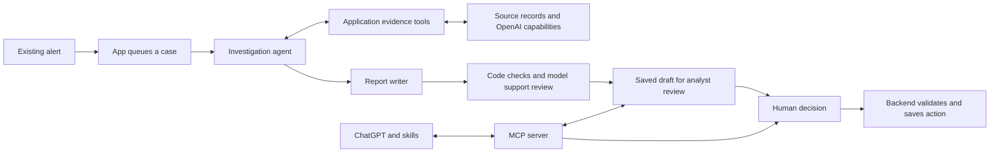

# Trade Surveillance Demo — What I Built

Use this guide to explain the solution, demonstrate your contribution, and distinguish application code from OpenAI capabilities. Code links are relative to this repository so they also work on GitHub.

## The opening: 30 seconds

> I built an application that helps a surveillance analyst investigate an existing trade alert. It gathers trade records, communications, policy and other relevant evidence, prepares a cited assessment, and leaves the final decision with a person. I implemented the application, evidence tools, analysis recipe, validation and review workflow. OpenAI supplies the models, agent SDK and hosted AI capabilities. I also connected the application to ChatGPT through MCP so analysts can review cases conversationally and approve actions that update the same application.

This is a working prototype using synthetic private trading records and communications, with sourced public market context. It illustrates a production design; it does not establish regulatory compliance or production accuracy.

## What I built versus what OpenAI provides

| Area | My implementation | OpenAI's contribution |
|---|---|---|
| Analyst workspace | Case queues, evidence tabs, reports, review notes, history and application persistence | Models provide the assessments displayed by the app |
| Investigation | Instructions, tool definitions, evidence scoping, mandatory checks, tool budgets and failure handling | Agents SDK runs agents and tool calls; models choose among enabled tools |
| Retrieval | Database queries, account/time filters, similarity scoring and policy integration | Embeddings create vectors; hosted File Search retrieves policy excerpts |
| Audio and images | Recording/image selection, provenance, caching and extracted-quote checks | Transcription converts audio to text; a vision-capable model interprets screenshots |
| Quantitative analysis | Python recipe, scoped input, numerical validation and artifact storage | Hosted Code Interpreter executes Python and produces the calculation/chart artifacts |
| Report quality | Required structure, citation/quote checks, retry limits and hold-for-review behavior | Structured Outputs and a separate model support reviewer |
| ChatGPT access | MCP server, tool definitions, skills and custom chart/audio components | ChatGPT selects tools, formats answers, renders components and applies host tool-approval controls |
| Decisions | Proposal validation, current-revision checks, saved decisions, PDF/email workflow and audit records | ChatGPT provides the native approval experience when required |
| Observability | Trace instrumentation and evaluation criteria | Platform displays traces and runs configured evaluations |

Claude was a development assistant. It is not a model provider in the running investigation workflow. Likewise, the recipe demonstrates where customer-owned analytics could plug in; it is demo code, not code supplied by a real bank.

## The flow to explain

The automatic investigation and the ChatGPT connection are two entry points into the same application. Reading a saved case in ChatGPT does not start another investigation. The investigation agents do not have analyst-decision or email-sending tools.

## An 18-minute walkthrough

| Time | Show | What to say |
|---|---|---|
| 0:00–1:00 | Case queue and Apple case | Explain fragmented evidence and the goal: reduce preparation effort while maintaining review quality and human accountability. |
| 1:00–3:00 | Assessment and trades | Establish the alert, the initial view, what evidence changed it, and the competing hedge explanation. Separate observed behavior from inferred intent. |
| 3:00–5:30 | Communications, recording and Image evidence | Show a short relevant excerpt. Explain transcription and screenshot interpretation. The synthetic recording and rendered screenshot are derived evidence, not independent corroboration of their source records. |
| 5:30–7:00 | Trades & charts | Show the calculation and chart. Explain that supplied Python computes the measurements and Code Interpreter executes it. The chart alone does not establish intent or market impact. |
| 7:00–8:30 | Two code files | Show the Code Interpreter call, then the recipe's main function and calculate_metrics. Explain the return path to the agent. |
| 8:30–10:00 | Cited report, policy and review controls | Open one citation, explain validation and uncertainty, and show the human decision boundary. |
| 10:00–14:00 | ChatGPT | Invoke case-review, ask a focused follow-up, briefly show the plugin/skills, then demonstrate an approved decision and verify the app updates. Escalation can send a real manager email when configured. |
| 14:00–18:00 | Platform trace and evaluation | Show one successful analysis tool, its arguments and output, timing and a relevant evaluation. Explain debugging and the limits of the evaluation. |

This is a rehearsal budget, not a requirement to fill time. Leave room for discovery questions and follow the audience's interests.

## Apple case: the facts to keep straight

Case: **CASE-0088C625**, AAPL, Casey Morgan, account A05.

- Three sell orders execute 300 shares each: **900 shares sold** in total.
- Nine large displayed buy orders, each for 15,000 shares, are cancelled without executing in the supplied venue-order extract.
- The repeated sequence is large bids appearing shortly before each smaller sell fills, followed by cancellation of those bids.
- Examine the approved hedge-related strategy as an alternative explanation; do not infer intent solely from cancellation counts.
- Relevant communications add context. Explain the distinction between the original message, its synthetic voice reenactment, and the separate desk-chat screenshot.
- Daily public market data provides context; it does not prove the orders caused a price change.
- Historical similarity is an investigative lead, not proof that the current case has the same outcome. The authored historical reference is synthetic.

Say “Apple,” while explaining that AAPL is the ticker. Do not say “900 orders were cancelled.”

## The code tour: only open what supports the explanation

| Question | File / symbol | Explanation |
|---|---|---|
| Where is the Agents SDK? | [sdk_workflow.py](../app/sdk_workflow.py), `sdk_tools`, `run_sdk`, `execute` | Custom functions become SDK FunctionTools; Agent defines the investigator, writer and reviewer; Runner executes each stage. |
| What tells the agent how to investigate? | [agent.py](../app/agent.py), `INSTRUCTIONS`, `definitions` | Domain instructions, required checks and tool schemas. Instructions guide behavior; application checks enforce constraints. |
| Where does evidence come from? | [evidence_tools.py](../app/evidence_tools.py) | Scoped source queries, communications retrieval and hosted policy File Search. |
| Where are audio and images processed? | [investigation_extensions.py](../app/investigation_extensions.py), `transcribe_calls`; [image_evidence.py](../app/image_evidence.py), `read_image` | Audio transcription and Responses vision, with provenance and application checks. There is no separate “reasoning API” for screenshots. |
| Where is Code Interpreter called? | [quantitative.py](../app/quantitative.py), `analyze` | Uploads scoped data and the recipe, calls `responses.create` with a `code_interpreter` tool, and retrieves artifacts. |
| Where is the supplied Python recipe? | [execution_chart_recipe.py](../app/execution_chart_recipe.py), `main`, `calculate_metrics`, `render_chart` | Loads the supplied dataset, computes metrics and draws the chart. The model is instructed to execute this recipe rather than invent replacement calculations. |
| How are numerical results checked? | [quantitative.py](../app/quantitative.py), `measurements`, `validate_measurements` | Independently recomputes expected metrics before admitting results as evidence. This does not validate every chart pixel. |
| How are reports checked? | [agent.py](../app/agent.py), `validate_report`; [sdk_workflow.py](../app/sdk_workflow.py), writer/reviewer loop | Deterministic checks plus model support review, one repair attempt, then hold for attention if necessary. Model review is not proof of correctness. |
| Where is ChatGPT connected? | [chatgpt_mcp.py](../app/chatgpt_mcp.py) and [chatgpt_cases.py](../app/chatgpt_cases.py) | MCP exposes existing case reads, sources, charts and staged/submitted decisions. |
| Where are summary and detail instructions? | [case-review skill](../chatgpt-skills/skills/case-review/SKILL.md), [details skill](../chatgpt-skills/skills/details/SKILL.md), [escalate skill](../chatgpt-skills/skills/escalate/SKILL.md) | Skills guide concise summaries, deeper reads and the decision flow. They are not an access-control boundary or the source of native approval buttons. |
| Where are decisions recorded? | [reviews.py](../app/reviews.py), `record_review` | Shared application workflow validates and persists the action. Preparing a proposal is not submitting it. |
| Where are traces instrumented? | [observability.py](../app/observability.py) and [sdk_workflow.py](../app/sdk_workflow.py), `run_sdk` | Records execution activity and configures SDK tracing. |

### The Code Interpreter explanation

> The investigation agent selects my analysis tool. My backend scopes the trading records, uploads the dataset and supplied Python recipe, and calls Code Interpreter through the Responses API. Code Interpreter executes the recipe and returns the metrics and chart. My backend validates the numerical results and saves the artifacts. The tool then returns the checked evidence to the investigation agent for use in its assessment.

The path is: **agent → application tool → Responses / Code Interpreter → application validation → tool result → agent**. The visible workspace displays the saved results; the browser does not pass them to the agent.

## ChatGPT: what to demonstrate and explain

Start with `case-review` and the case ID for a concise summary. Use `details` or an ordinary follow-up to retrieve only the evidence you want to discuss. Skills were installed directly in the browser account and verified in the Work-mode slash picker. Plugin-bundled skills also remain present; availability of a picker depends on the host and surface.

> I exposed application capabilities as MCP tools and provided skills that guide how they are used. ChatGPT retrieves live case information, gives a concise first answer, and can retrieve deeper evidence on request. For a consequential action, it prepares a proposal and follows the host's approval flow. The backend validates and saves the approved action in the same application.

Presentation has three distinct sources:

- ChatGPT generates normal text formatting, lists, tables, timelines and links from tool results; their exact layout can vary.
- Tool metadata explicitly attaches custom HTML/JavaScript components for experiences such as chart and audio display.
- ChatGPT owns its native tool-approval interface. Write annotations describe the tool; actual approval behavior also depends on host policy and permissions.

Use a fresh case read before discussing current status. Old conversation messages and historical revisions may still show earlier escalations. A ready-for-review case can still have an **agent recommendation to escalate**; that recommendation is not an analyst decision.

## Traces and evals: the talk track

> The trace makes the execution path inspectable: which tools ran, their arguments and outputs, timing and failures. I can use that to debug an incomplete investigation or identify a slow step. It shows recorded execution, not private model reasoning, and does not by itself prove the report is correct.

Show one successful `analyze_execution_patterns` call. Its arguments express the analysis request; the application constructs the scoped dataset. Inspect the returned measurements and artifact metadata, and, if available, the nested hosted Code Interpreter execution.

For a broad trace evaluation, use **Tool execution and result consistency**: require a successful relevant tool, consistency between subsequent claims and its output, and no false claims of success after an unresolved failure. Name this a basic reliability check, not a complete investigation-quality test.

For a pilot, separately evaluate expert-labeled cases for evidence coverage, supported claims, material gaps, appropriate recommendations and legitimate/ambiguous scenarios. Measure missed concerning cases and unnecessary escalations with explicit denominators. The prototype's synthetic results do not establish production false-positive or false-negative rates.

## Security and governance: 45 seconds

> OpenAI protects data within its services, and API data is not used for model training by default. The application must protect its own records, files and credentials. Retention depends on the API, hosted tools and account settings; store=false does not establish Zero Data Retention. The organization defines access policies, the application enforces case permissions, and people approve consequential actions. Before production, we would validate identity, encryption, retention, residency and evaluation thresholds with security and compliance.

Current implementation: the principal SDK agents use `store=True`; vision and Code Interpreter calls use `store=False`. Traces can include evidence when enabled. The app retains reports and artifacts separately. Production enterprise identity and complete case-level authorization are not implemented by this single-user demo.

## Before the demo

1. Start the original app copy and open the Apple case. Confirm its latest revision, report, chart and current review status.
2. Check the MCP connection and retrieve the latest case in ChatGPT. Do not rely on an older response's status.
3. Confirm the slash skills are visible in browser Work mode and select the intended plugin connection.
4. Open a completed trace and its successful evaluation in advance. Confirm available API credit before running new evaluations or investigations.
5. Decide whether to actually escalate. A real escalation can generate a PDF and queue manager email. Verify the application after a submitted action; “prepared” and “queued” are not “submitted” and “delivered.”
6. Keep a saved completed report as backup. A copied review revision reuses evidence; do not describe it as a freshly executed agent run.

Vercel migration is paused. The local workspace is the demonstrated deployment. Source code is also in the GitHub repository; runtime data, secrets and generated artifacts are not the repository.

## The close: 20 seconds

> The value is less time assembling evidence and more consistent preparation for human review. The next step is a controlled pilot: establish a baseline, test expert-reviewed cases, measure quality and workflow latency, and track weekly use by the pilot cohort. We scale only after quality, security and operational criteria are met.

Present adoption and latency numbers in the deck as proposed pilot targets, not achieved results or universal benchmarks.
